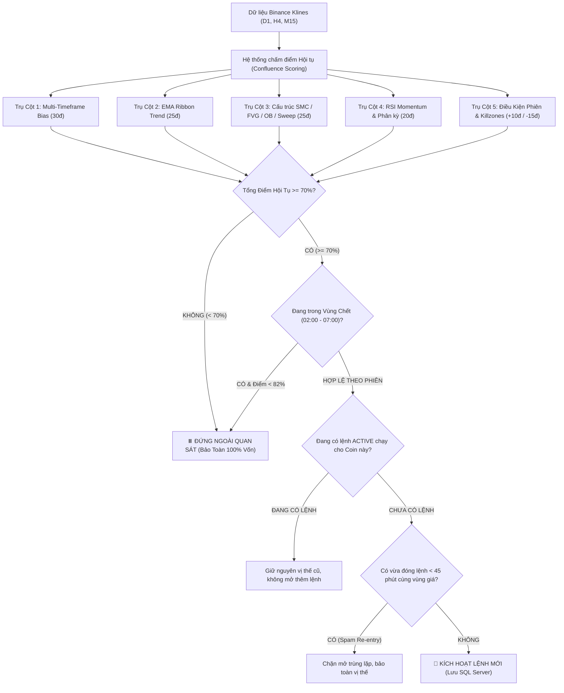

# 📘 TÀI LIỆU HƯỚNG DẪN SỬ DỤNG & PHƯƠNG PHÁP GIAO DỊCH
### BINANCE CYCLE INTELLIGENCE & AUTONOMOUS SMC TRACKER
*Phiên bản: 2.0 (Kiến trúc C# .NET 9 + SQL Server + Tiến trình ngầm 24/7)*

---

## 📑 MỤC LỤC
1. [Tổng Quan Hệ Thống](#1-tổng-quan-hệ-thống)
2. [Hướng Dẫn Cài Đặt & Khởi Chạy Nhanh](#2-hướng-dẫn-cài-đặt--khởi-chạy-nhanh)
3. [Chi Tiết Các Thành Phần Trên Giao Diện Dashboard](#3-chi-tiết-các-thành-phần-trên-giao-diện-dashboard)
4. [Phương Pháp & Thuật Toán Giao Dịch (ICT / SMC Confluence)](#4-phương-pháp--thuật-toán-giao-dịch-ict--smc-confluence)
5. [Quy Tắc Quản Trị Rủi Ro & Cơ Chế Nhật Ký Lệnh (Trade Journal)](#5-quy-tắc-quản-trị-rủi-ro--cơ-chế-nhật-ký-lệnh-trade-journal)
   * [5.1. Ba Nguyên Tắc Sống Còn Trong Quản Trị Vốn](#51-ba-nguyên-tắc-sống-còn-trong-quản-trị-vốn)
   * [5.2. Cách Đọc Dữ Liệu Trên Bảng Nhật Ký Lệnh](#52-cách-đọc-dữ-liệu-trên-bảng-nhật-ký-lệnh)
   * [5.3. Bảng Tra Cứu Phân Bổ Vốn 50$ (Đòn Bẩy, SL Mất Bao Nhiêu & TP Lãi Bao Nhiêu)](#53-bảng-tra-cứu-phân-bổ-vốn-50-đòn-bẩy-sl-mất-bao-nhiêu--tp-lãi-bao-nhiêu)
6. [Cơ Chế Vận Hành Tự Động 24/7 Khi Tắt Dự Án](#6-cơ-chế-vận-hành-tự-động-247-khi-tắt-dự-án)
7. [Xử Lý Sự Cố Thường Gặp (Troubleshooting & FAQ)](#7-xử-lý-sự-cố-thường-gặp-troubleshooting--faq)

---

## 1. TỔNG QUAN HỆ THỐNG

### 1.1. Mục Tiêu Của Dự Án
Hệ thống được thiết kế để giải quyết bài toán lớn nhất của nhà đầu tư tiền mã hóa: **Loại bỏ hoàn toàn cảm xúc, sự nóng vội (FOMO) và tâm lý hoảng loạn** thông qua việc kết hợp 3 tầng phân tích dữ liệu:
1. **Tầng Vĩ Mô (Macro Cycle)**: Mô hình chu kỳ Halving 4 năm của Bitcoin, Bội số Mayer, Định giá dòng tiền tổ chức (VanEck, Standard Chartered, Bernstein).
2. **Tầng Vi Mô & Dòng Tiền Phái Sinh (Micro & Derivatives)**: Dữ liệu thời gian thực từ Binance Futures (Funding Rate, Tỷ lệ Long/Short, Open Interest, Liquidation Heatmap).
3. **Tầng Kích Hoạt Lệnh (Execution & SMC)**: Chiến lược Smart Money Concepts (SMC) và ICT (Inner Circle Trader) tự động nhận diện Vùng mất cân bằng giá (FVG), Khối lệnh tổ chức (Order Block), Quét thanh khoản (Liquidity Sweep) và phân kỳ động lượng RSI.

### 1.2. Kiến Trúc Hợp Nhất
Dự án được tinh gọn thành **một khối độc lập duy nhất** bằng C# .NET 9:
* **Backend Web API**: Xử lý dữ liệu nến, tính toán thuật toán định lượng, kết nối trực tiếp sàn Binance.
* **Cơ sở dữ liệu Microsoft SQL Server**: Lưu trữ bền vững toàn bộ lịch sử tín hiệu lệnh, giá vào, giá cắt lỗ (SL), 3 mức chốt lời (TP) và hiệu suất PnL thực tế.
* **Autonomous Worker 24/7**: Tiến trình ngầm tự động quét và giám sát thị trường mỗi 25 giây, không phụ thuộc vào trình duyệt web.
* **Web Dashboard Tích Hợp (Cổng 5166)**: Giao diện web trực quan, tải nhanh tức thì, đồng bộ WebSocket giá live từng tick.

---

## 2. HƯỚNG DẪN CÀI ĐẶT & KHỞI CHẠY NHANH

### 2.1. Yêu Cầu Môi Trường
* **Hệ điều hành**: Windows 10/11 hoặc Windows Server / Linux.
* **.NET 9.0 SDK**: [Tải từ Microsoft .NET](https://dotnet.microsoft.com/download/dotnet/9.0).
* **Microsoft SQL Server**: Bản Express hoặc Standard (hoặc LocalDB).

### 2.2. Cấu Hình Cơ Sở Dữ Liệu
Hệ thống sử dụng cơ sở dữ liệu `BinanceTracker` trên SQL Server. Cấu hình chuỗi kết nối nằm tại [backend/appsettings.json](file:///d:/2026/Binance/backend/appsettings.json):
```json
{
  "ConnectionStrings": {
    "DefaultConnection": "Data Source=.;Initial Catalog=BinanceTracker;Persist Security Info=True;User ID=admin;Password=shc@1234;Pooling=False;MultipleActiveResultSets=True;Encrypt=True;TrustServerCertificate=True;Command Timeout=0"
  }
}
```
> [!NOTE]
> Khi khởi chạy lần đầu, hệ thống sẽ **tự động kiểm tra và tạo bảng `[dbo].[TradeSignals]`** nếu chưa có, đồng thời khởi tạo các chỉ mục tối ưu truy vấn tốc độ cao.

### 2.3. Lệnh Khởi Chạy
Mở PowerShell hoặc Command Prompt tại thư mục dự án và chạy:
```powershell
cd d:\2026\Binance\backend
dotnet run --urls=http://localhost:5166
```

Sau khi màn hình hiển thị log thông báo:
```text
info: Microsoft.Hosting.Lifetime[14]
      Now listening on: http://localhost:5166
info: BinanceTracker.Api.Workers.AutonomousTradeWorker[0]
      >>> [AUTONOMOUS WORKER] Đã khởi động dịch vụ quét ngầm tự động 24/7...
```

👉 Mở trình duyệt web bất kỳ (Chrome, Edge, Cốc Cốc, Safari) truy cập: **[http://localhost:5166](http://localhost:5166)**.

---

## 3. CHI TIẾT CÁC THÀNH PHẦN TRÊN GIAO DIỆN DASHBOARD

Giao diện [index.html](file:///d:/2026/Binance/backend/wwwroot/index.html) được chia thành các khu vực chức năng rõ ràng:

### 3.1. Thanh Chọn Coin & Dữ Liệu Thời Gian Thực (Header Bar)
* **Các đồng coin theo dõi chính**: Hỗ trợ 5 đồng coin nền tảng lớn nhất thị trường: `BTC`, `ETH`, `BNB`, `SOL`, `NEAR`.
* **Live WebSocket Tick-by-Tick**: Kết nối trực tiếp luồng `wss://stream.binance.com:9443` với độ trễ 0ms.
* **Hiệu ứng nhấp nháy giá (Flash Animation)**: Giá vừa có lệnh mua đẩy lên sẽ lóe xanh; khi bị bán ép xuống sẽ lóe đỏ tức thì.
* **Chỉ số Tâm Lý Sợ Hãi & Tham Lam (Fear & Greed Index)**: Cập nhật chỉ số từ Alternative.me, cảnh báo vùng cực đoan (Extreme Fear < 25 là cơ hội gom hàng, Extreme Greed > 75 là vùng chốt lời).

### 3.2. Biểu Đồ Nến Kỹ Thuật Tương Tác
* Hiển thị nến chuẩn sàn Binance với khung thời gian tùy chọn (`15M`, `1H`, `4H`, `1D`).
* Tích hợp 2 đường trung bình động cốt lõi:
  * **Đường MA 50 (Vàng cam)**: Thể hiện xu hướng ngắn và trung hạn.
  * **Đường MA 200 (Xanh lam)**: Đường ranh giới sinh tử xác định chu kỳ Bull Market hay Bear Market.

### 3.3. Phân Tích Chu Kỳ Halving & Định Giá Đỉnh
* **Đồng hồ đếm ngược Halving 4 năm**: Đo lường số ngày đã trôi qua kể từ đợt Halving gần nhất (20/04/2024) và đếm ngược tới kỳ Halving tiếp theo (~Tháng 04/2028).
* **Bội số Mayer (Mayer Multiple)**: Tỷ số giữa Giá hiện tại / Đường SMA 200 Ngày:
  * `< 0.8`: Vùng giá chiết khấu sâu, gom hàng dài hạn.
  * `1.0 - 1.5`: Xu hướng tăng trưởng lành mạnh.
  * `> 2.4`: Vùng bong bóng đầu cơ, báo hiệu đạt đỉnh chu kỳ.
* **Pi Cycle Top Indicator**: So sánh giữa đường SMA 111 ngày và đường SMA 350 ngày x 2. Khi 2 đường này giao nhau là chỉ báo đỉnh lịch sử có độ chính xác 95%.
* **Điểm Rủi Ro Chu Kỳ (Risk Score 1 - 10)**: Giúp bạn biết tỷ trọng nắm giữ tiền mặt hay crypto an toàn.

### 3.4. Dữ Liệu Phái Sinh & Hợp Đồng Tương Lai (Binance Futures)
* **Tỷ Lệ Phí Cấp Vốn (Funding Rate 8H & APR quy đổi theo năm)**:
  * Funding dương cao (> 0.03%): Phe Long đang trả phí cho Short, thị trường quá hưng phấn, nguy cơ bẫy Long Squeeze quét râu giảm.
  * Funding âm sâu (< -0.02%): Phe Short ồ ạt bán khống, nguy cơ kích hoạt Short Squeeze quét lên mạnh mẽ.
* **Tỷ Lệ Long / Short Accounts**: Đo lường tỷ lệ tài khoản cá nhân đang theo chiều Long hay Short.
* **Khối Lượng Hợp Đồng Mở (Open Interest - OI)**: Tổng giá trị vị thế đang mở tính bằng USD và số lượng coin.
* **Bản Đồ Cụm Thanh Lý Hợp Đồng (Liquidation Heatmap)**: Tính toán chính xác vùng giá mà hàng trăm triệu USD đòn bẩy 20x, 30x, 50x sẽ bị kích hoạt thanh lý cưỡng bức.

---

## 4. PHƯƠNG PHÁP & THUẬT TOÁN GIAO DỊCH (ICT / SMC CONFLUENCE)

Hệ thống **không giao dịch theo cảm tính hay chỉ báo chậm thông thường**, mà được mã hóa theo phương pháp **Smart Money Concepts (SMC)** và **Inner Circle Trader (ICT)** kết hợp đa khung thời gian.



### 4.1. Hệ Thống Chấm Điểm Hội Tụ (Thang 100 Điểm)
Để một tín hiệu được coi là hợp lệ để mở lệnh, điểm số hội tụ (Confidence Score) **bắt buộc phải vượt qua 70%** (`> 70%`) và phe chiếm ưu thế phải hơn phe đối nghịch ít nhất 8 điểm:

| Trụ cột đánh giá | Trọng số | Tiêu chí kỹ thuật chi tiết |
| :--- | :---: | :--- |
| **Trụ Cột 1: Đồng pha đa khung (Daily Bias)** | **30 Điểm** | Khung ngày (D1) định hình xu hướng vĩ mô + Khung 4 giờ (H4) xác nhận nhịp sóng trung hạn. Khi cả D1 và H4 cùng là BULLISH (hoặc cùng BEARISH) sẽ được cộng tối đa 30 điểm. |
| **Trụ Cột 2: Đường trung bình xu hướng EMA** | **25 Điểm** | Giá duy trì trên EMA 20, EMA 50 và đường EMA 20 nằm trên EMA 50 (cho lệnh Long) hoặc nằm dưới (cho lệnh Short). |
| **Trụ Cột 3: Cấu trúc SMC (BOS, OB, FVG, Sweep)** | **25 Điểm** | **1) BOS (Break of Structure)**: Phá vỡ đỉnh/đáy gần nhất tạo xu hướng.<br>**2) Order Block (OB)**: Khối lệnh đỡ giá của Market Maker.<br>**3) Fair Value Gap (FVG)**: Vùng mất cân bằng cung cầu giữa 3 cây nến.<br>**4) Liquidity Sweep**: Đã quét sạch thanh khoản BSL (Buy-side) hoặc SSL (Sell-side). |
| **Trụ Cột 4: Động lượng RSI & Phân kỳ** | **20 Điểm** | RSI 14 nằm trong vùng động lượng lành mạnh (42 - 65 cho Long, 35 - 58 cho Short). Thưởng lớn (+12 điểm) khi phát hiện **Phân kỳ ẩn hoặc Phân kỳ thường (Bullish/Bearish Divergence)** báo hiệu đảo chiều chuẩn xác. Có trừ điểm phạt (-12đ) nếu RSI quá mua > 72 hoặc quá bán < 28 để tránh đu đỉnh bán đáy. |
| **Trụ Cột 5: Điều Kiện Phiên & Killzones (Mới)** | **+10đ / -15đ** | **Thưởng điểm theo dòng tiền tổ chức:**<br>• *New York Open Killzone*: Thưởng **+10 điểm** (Thanh khoản bùng nổ).<br>• *London Open Killzone*: Thưởng **+8 điểm** (Săn thanh khoản Judas Swing).<br>• *Phiên Á*: Thưởng **+3 điểm** (Tích lũy biên độ).<br>• *Vùng Chết (02:00 - 07:00)*: **Trừ phạt -15 điểm** và khóa mở lệnh thông thường. |

### 4.2. Chiến Lược Giao Dịch Theo Phiên (ICT Session Trading & Killzones)
Hệ thống tự động đồng bộ thời gian thực theo **Giờ Việt Nam (GMT+7)** và chia làm 4 phiên giao dịch đặc trưng:

1. 🏛️ **Phiên Mỹ (New York Session - 19:00 đến 02:00 Giờ VN)**:
   * **Giờ Vàng (New York Open Killzone - 19:30 đến 23:30)**: Khung giờ các quỹ ETF, Phố Wall và ngân hàng lớn tại Mỹ mở cửa giao dịch.
   * **Chiến lược**: Dòng tiền tổ chức lớn nhất toàn cầu. Thích hợp đánh bứt phá (Breakout) và nương theo sóng lớn. Lệnh mở tại phiên này có tỷ lệ cán mốc TP2 và TP3 cao nhất.
2. 🏰 **Phiên Âu (London Session - 14:00 đến 19:00 Giờ VN)**:
   * **Giờ Vàng (London Open Killzone - 14:00 đến 17:30)**: Khung giờ các trung tâm tài chính London, Frankfurt nhập cuộc.
   * **Chiến lược**: Nhận diện bẫy giá giả mạo (**Judas Swing**) quét sạch thanh khoản đỉnh/đáy của phiên Á, sau đó mở ra xu hướng chính của ngày.
3. ⛩️ **Phiên Á (Asian Session / Tokyo - 07:00 đến 14:00 Giờ VN)**:
   * **Chiến lược**: Thị trường chủ yếu đi ngang tích lũy tạo biên độ (**Asian Range**). Khuyến nghị chốt lời gần tại mốc TP1 (1.5R) hoặc gom tích lũy đón sóng phiên Âu.
4. 🌙 **Vùng Chết (Off-Hours / Low Liquidity - 02:00 đến 07:00 sáng Giờ VN)**:
   * **Cơ chế bảo vệ vốn ban đêm**: Cả thị trường Mỹ và châu Âu đều đã đóng cửa, châu Á chưa mở cửa. Thanh khoản cực mỏng, chênh lệch spread giãn rộng, dễ xuất hiện râu nến ảo giật 2 đầu quét Stop Loss bất thường.
   * **Quy tắc hệ thống**: **Tự động kích hoạt cơ chế phòng vệ**, trừ -15 điểm phạt và **từ chối mở lệnh mới** trừ khi thị trường xuất hiện setup đặc biệt với độ hội tụ siêu mạnh ($\ge 82\%$).

### 4.3. Công Thức Xác Định Điểm Vào Lệnh & Chốt Lời / Dừng Lỗ
  * *Lệnh LONG*: Canh đón tại cạnh dưới của vùng mất cân bằng tăng giá (`Bullish FVG Low`) hoặc retest khối lệnh cầu (`Order Block Low`).
  * *Lệnh SHORT*: Canh bán tại cạnh trên của vùng mất cân bằng giảm giá (`Bearish FVG High`) hoặc cản khối lệnh cung (`Order Block High`).
* **Điểm Cắt Lỗ Nghiêm Ngặt (Stop Loss - SL)**:
  * Luôn đặt vượt ra ngoài rìa bảo vệ của khối Order Block (Dưới đáy nến OB với lệnh Long, trên đỉnh nến OB với lệnh Short).
* **3 Mốc Chốt Lời (Take Profit - TP)**:
  * **TP1 (Tỷ lệ 1.5R)**: Chốt 30% - 40% khối lượng để thu hồi rủi ro. **Ngay khi giá chạm TP1, tự động dời Stop Loss về giá vào lệnh (Break-even)** để giao dịch trở thành vị thế không còn rủi ro.
  * **TP2 (Tỷ lệ 2.5R hoặc Swing High/Low)**: Mục tiêu chính để chốt 40% khối lượng tiếp theo.
  * **TP3 (Tỷ lệ 3.8R - Max Runner)**: Thả trôi 20% khối lượng còn lại theo sóng thị trường.

---

## 5. QUY TẮC QUẢN TRỊ RỦI RO & CƠ CHẾ NHẬT KÝ LỆNH (TRADE JOURNAL)

Bảng **"Bảng Lưu Trữ Lịch Sử Lệnh & Giám Sát Kết Quả (Entry - SL - TP Journal)"** là trái tim của hệ thống giám sát.

### 5.1. Ba Nguyên Tắc Sống Còn Trong Quản Trị Vốn
1. **Nguyên tắc "1 Coin - 1 Vị Thế Duy Nhất"**:
   * Khi một đồng coin (ví dụ BTC) đã đưa ra một lệnh đang chạy (`ACTIVE`), hệ thống **tuyệt đối không mở thêm bất kỳ lệnh nào khác** cho coin đó cho đến khi lệnh cũ chạm TP hoặc SL. Điều này triệt tiêu hoàn toàn thói quen nhồi lệnh mạo hiểm (Averaging Down / Martingale).
2. **Cơ chế Chống Vào Lệnh Trùng Lặp (Anti-Spam Re-entry)**:
   * Sau khi một lệnh vừa đóng (dù thắng hay thua), trong vòng **45 phút kế tiếp**, nếu có tín hiệu cùng chiều mà giá Entry lệch dưới `0.6%`, hệ thống sẽ **bỏ qua**, tránh trường hợp vừa chạm SL lại nhảy vào mua lại ngay tại vùng tranh chấp nguy hiểm.
3. **Giám Sát Tự Động Theo Giá Mark Price Thật**:
   * Hệ thống so sánh SL/TP bằng giá **Mark Price** chính thức của Binance Futures (giá được tính toán từ chỉ số spot của nhiều sàn lớn), giúp bạn không bị quét râu ảo hay lỗi giá cục bộ.

### 5.2. Cách Đọc Dữ Liệu Trên Bảng Nhật Ký Lệnh
* **Mã / Khung Giờ**: Kèm mã định danh giao dịch duy nhất (ví dụ `BTCUSDT • 15M • TRD-AA4A6C`).
* **Vị Thế**: Hiển thị rõ `▲ LONG` (Xanh lục) hoặc `▼ SHORT` (Đỏ tươi).
* **Độ Tin Cậy**: Điểm số hội tụ từ 70% đến 95%.
* **Thời Điểm Vào / Thời Điểm Đóng (Giờ VN)**: Đã được cấu hình tự động quy đổi chính xác theo **Giờ Việt Nam (GMT+7 / ICT)** định dạng `dd/MM HH:mm` (ví dụ: `24/10 08:48`).
* **Trạng Thái Vị Thế**:
  * `⏳ Đang Chạy (ACTIVE)`: Vị thế đang mở, hệ thống quét giá liên tục.
  * `🎯 Chạm TP1`: Đã chốt lời mốc 1.
  * `🏆 Chạm TP2`: Đã chốt lời mốc chính 2.5R.
  * `🚀 Chạm TP3 Max`: Đạt lợi nhuận cực đại.
  * `🛑 Dính SL`: Chạm ngưỡng cắt lỗ kỷ luật để bảo vệ vốn.
* **Hiệu Suất PnL**: Tính toán chính xác phần trăm lãi/lỗ dựa trên tỷ lệ chênh lệch giá Entry và Exit.
* **Ghi Chú Kỹ Thuật**: Liệt kê chi tiết lý do vào lệnh (hội tụ đa khung, vị trí FVG, Order Block, RSI...).

### 5.3. Bảng Tra Cứu Phân Bổ Vốn 50$ (Đòn Bẩy, SL Mất Bao Nhiêu & TP Lãi Bao Nhiêu)

Khi tham gia giao dịch Futures với ngân sách **$50 USDT tiền ký quỹ (Margin)** cho mỗi lệnh, bài toán cốt lõi là: *Chọn đòn bẩy bao nhiêu để vừa có khoảng Stop Loss đủ rộng chống quét râu nến (wick hunting), vừa kiểm soát số tiền mất ở mức nhỏ nhất khi thị trường đảo chiều bất lợi?*

#### 1. Nguyên Tắc Tránh Quét Râu (Wick Protection)
* **Biên độ quét râu nến thông thường**:
  * **BTC / ETH**: Râu giật trung bình dao động từ `1.2% - 2.2%`. Do đó, khoảng cách Stop Loss an toàn phải duy trì từ **2.0% đến 2.5%** tính từ giá Entry (đặt dưới đáy Order Block hoặc FVG).
  * **Altcoin (SOL, NEAR)**: Biên độ biến động lớn hơn, râu giật `2.5% - 3.5%`. Khoảng cách SL an toàn tối thiểu nên là **3.0% đến 4.0%**.
* **Hậu quả của đòn bẩy quá cao (20x, 50x)**: Với đòn bẩy 20x hay 50x, mức chịu đựng giá chỉ có `0.8% - 1.5%`. Chỉ cần một cây nến giật nhẹ trong phiên là lệnh đã bị thanh lý hoặc dính SL trước khi thị trường kịp bứt phá đúng hướng dự đoán.

#### 2. Công Thức Tính Toán Định Lượng
$$\text{Quy Mô Vị Thế (Position Size)} = \text{Vốn Ký Quỹ (Margin)} \times \text{Đòn Bẩy (Leverage)}$$
$$\text{Số Tiền Mất Khi Dính SL (USDT)} = \text{Quy Mô Vị Thế} \times \text{Khoảng Cách SL (\%)} = \text{Margin} \times \text{Đòn Bẩy} \times \text{Khoảng Cách SL (\%)} $$
$$\text{Tỷ Lệ Mất Trên Vốn Bỏ Ra (\%)} = \text{Đòn Bẩy} \times \text{Khoảng Cách SL (\%)} $$

#### 3. Bảng Tra Cứu Chi Tiết Với Vốn Bỏ Ra 50$ Margin

| Mức Đòn Bẩy | Quy Mô Vị Thế | Khoảng Cách SL Chống Quét | **Số Tiền Mất Khi Dính SL** | Tỷ Lệ Mất Trên Vốn $50 | Tiền Còn Lại Bảo Vệ Được | Chạm TP1 (+3.3%) | Chạm TP2 (+5.5%) | Đánh Giá Khuyên Dùng |
| :--- | :---: | :---: | :---: | :---: | :---: | :---: | :---: | :--- |
| **3x (Bảo Thủ)** | $150 USDT | 2.5% - 3.5% | **-$3.75 đến -$5.25** | Mất 7.5% - 10.5% | **$44.75 - $46.25** (Giữ 90% vốn) | +$4.95 (+9.9%) | +$8.25 (+16.5%) | Cực kỳ an toàn, thích hợp giai đoạn thị trường biến động giông bão. |
| **5x (KHUYÊN DÙNG)** | **$250 USDT** | **2.2% - 3.0%** | **-$5.50 đến -$7.50** | **Mất 11.0% - 15.0%** | **$42.50 - $44.50** (Giữ 85% - 89% vốn) | **+$8.25 (+16.5%)** | **+$13.75 (+27.5%)** | 🌟 **Tối ưu nhất**: SL rộng rãi tránh quét râu, thua mất rất ít ($5 - $7), ăn thì đậm ($13 - $21). |
| **10x (Tiêu Chuẩn)** | $500 USDT | 2.0% - 2.5% | **-$10.00 đến -$12.50** | Mất 20.0% - 25.0% | **$37.50 - $40.00** (Giữ 75% - 80% vốn) | +$16.50 (+33.0%) | +$27.50 (+55.0%) | Chỉ dùng cho BTC/ETH khi có tín hiệu phân kỳ xác nhận rất mạnh. |
| **15x (Mạo Hiểm)** | $750 USDT | 1.8% - 2.0% | **-$13.50 đến -$15.00** | Mất 27.0% - 30.0% | **$35.00 - $36.50** (Giữ 70% vốn) | +$24.75 (+49.5%) | +$41.25 (+82.5%) | Dễ bị râu nến quét văng trước khi giá tăng, không khuyến khích. |
| **20x (Nguy Hiểm)** | $1,000 USDT | 1.5% - 1.8% | **-$15.00 đến -$18.00** | Mất 30.0% - 36.0% | **$32.00 - $35.00** | +$33.00 (+66.0%) | +$55.00 (+110%) | ⚠️ Rủi ro quét râu cực lớn, chỉ 1 nhịp rung lắc nhẹ là mất lệnh. |

#### 4. Kịch Bản Giao Dịch Mẫu Với Vốn 50$ (Đòn bẩy 5x)
1. **Cài đặt vị thế trên Binance Futures**:
   * Chế độ Ký Quỹ: **Isolated** (Cô lập – chỉ dùng đúng $50 cho lệnh này, không ảnh hưởng số dư tài khoản).
   * Đòn bẩy: **5x**.
   * Số tiền vào lệnh (Margin): **$50 USDT** $\rightarrow$ Sàn tự hiểu quy mô vị thế là **$250 USDT**.
2. **Kịch bản xấu - Dính Stop Loss (-2.2%)**:
   * Hệ thống tự động kích hoạt cắt lỗ kỷ luật.
   * Số tiền mất: **-$5.50 USDT** (khoảng 140.000 VNĐ).
   * Bạn bảo vệ được **$44.50 USDT** còn lại trong tài khoản (chỉ mất đúng 11% vốn bỏ ra). Bạn có thể thua liên tiếp 8-9 lệnh như vậy mới hao hụt một nửa vốn.
3. **Kịch bản tốt - Chạm các mốc Take Profit**:
   * Chạm **TP1 (+3.3%)**: Lãi **+$8.25 USDT** (+16.5% vốn $50) $\rightarrow$ Dời SL về giá vào lệnh (Break-even).
   * Chạm **TP2 (+5.5%)**: Lãi **+$13.75 USDT** (+27.5% vốn $50).
   * Chạm **TP3 (+8.5%)**: Lãi **+$21.25 USDT** (+42.5% vốn $50).

> [!TIP]
> **Công Cụ Mô Phỏng Trực Quan Trên Web**: Trên giao diện Dashboard [http://localhost:5166](http://localhost:5166), ngay dưới phần ICT SMC Tracker đã được trang bị thanh công cụ **"Mô Phỏng Phân Bổ Vốn Thực Chiến (Vốn Bỏ Ra 50$)"**. Bạn có thể tùy chỉnh vốn ($50, $100...) và đòn bẩy (3x, 5x, 10x) để xem bảng tính tự động cập nhật số tiền SL và TP theo giá thị trường trực tiếp.

---

## 6. CƠ CHẾ VẬN HÀNH TỰ ĐỘNG 24/7 KHI TẮT DỰ ÁN

Hệ thống hỗ trợ cơ chế chạy ngầm thông minh, bạn có thể lựa chọn tùy theo điều kiện máy tính của mình:

### 6.1. Khi Tắt Trình Duyệt Web (Tab / Chrome / Edge)
* **Bạn hoàn toàn có thể tắt tab hoặc đóng trình duyệt bất kỳ lúc nào.**
* Dịch vụ ngầm **`AutonomousTradeWorker`** trong C# .NET vẫn liên tục chạy nền:
  * Mỗi 25 giây tự động duyệt qua 5 coin (`BTC`, `ETH`, `BNB`, `SOL`, `NEAR`).
  * Tự động lấy giá Binance Futures Mark Price để kiểm tra chạm SL/TP.
  * Tự động phân tích nến 15M và ghi nhận lệnh mới vào SQL Server.
  * Khi bạn mở lại trình duyệt web sau vài tiếng hoặc vài ngày, toàn bộ lịch sử lệnh đã được lưu trữ đầy đủ.

### 6.2. Khi Muốn Tắt Cửa Sổ Dòng Lệnh Đen (Terminal) Trên Máy Tính
Nếu máy tính của bạn vẫn bật làm việc nhưng bạn không muốn nhìn thấy cửa sổ dòng lệnh:
1. Cài đặt công cụ quản lý tiến trình chạy ngầm PM2:
   ```powershell
   npm install -g pm2
   ```
2. Khởi động backend ngầm:
   ```powershell
   cd d:\2026\Binance
   pm2 start "dotnet run --project backend" --name "binance-tracker"
   ```
3. Lúc này bạn có thể đóng toàn bộ cửa sổ terminal. Dự án vẫn âm thầm chạy ngầm dưới nền Windows.

### 6.3. Khi Muốn Tắt Hẳn Máy Tính Cá Nhân (Shutdown PC / Đi Ngủ)
* Khi máy tính cá nhân bị tắt nguồn (shutdown), toàn bộ vi xử lý và SQL Server trên máy bạn sẽ ngừng hoạt động.
* **Giải pháp để chạy 24/7/365 kể cả khi tắt máy tính**:
  1. Thuê 1 máy chủ ảo **Cloud VPS** (giá chỉ từ 80.000đ - 120.000đ/tháng tại Vietnix, CloudFly, AZDIGI, Hetzner, Vultr...).
  2. Kéo mã nguồn từ GitHub (`https://github.com/mrdat1998-it/Binance`) về VPS.
  3. Bật dự án chạy trên VPS. VPS đặt ở trung tâm dữ liệu luôn có điện và internet tốc độ cao 24/24. Dù bạn tắt máy tính cá nhân hay đi ngủ, hệ thống vẫn liên tục quét và ghi nhật ký lệnh. Bất cứ khi nào bạn mở điện thoại hay máy tính lên, chỉ cần truy cập vào địa chỉ IP của VPS là xem được kết quả.

---

## 7. XỬ LÝ SỰ CỐ THƯỜNG GẶP (TROUBLESHOOTING & FAQ)

### ❓ Câu hỏi 1: Tại sao có những thời điểm không thấy hệ thống sinh ra lệnh mới?
* **Trả lời**: Đây là **tính năng bảo vệ tài khoản quan trọng nhất**. Hệ thống chỉ cho phép vào lệnh khi độ hội tụ điều kiện kỹ thuật đạt **trên 70% (> 70%)**. Vào những thời điểm thị trường đi ngang (Sideway), nén tích lũy, các khung giờ xung đột nhau (ví dụ D1 tăng nhưng H4 giảm), hệ thống sẽ kiên quyết kích hoạt trạng thái **"⏸️ ĐỨNG NGOÀI QUAN SÁT (Bảo Toàn 100% Vốn)"** để tránh bị thị trường bào mòn tài khoản.

### ❓ Câu hỏi 2: Tại sao một đồng coin đang có lệnh chạy thì không thấy có thêm lệnh mới?
* **Trả lời**: Hệ thống tuân thủ nguyên tắc kỷ luật: **Mỗi coin chỉ có tối đa 1 lệnh chạy**. Trong lúc lệnh đó chưa dính SL hoặc TP thì sẽ không mở thêm bất kỳ lệnh nào khác, tránh rủi ro chồng chéo vị thế.

### ❓ Câu hỏi 3: Lỗi không kết nối được SQL Server khi khởi chạy `dotnet run`?
* **Trả lời**: Kiểm tra 2 điểm:
  1. Đảm bảo dịch vụ `SQL Server (MSSQLSERVER)` trong Windows Services (`services.msc`) đang ở trạng thái `Running`.
  2. Kiểm tra mật khẩu tài khoản `admin` trong file [appsettings.json](file:///d:/2026/Binance/backend/appsettings.json) khớp với mật khẩu SQL Server của bạn.

### ❓ Câu hỏi 4: Thời gian lệnh hiển thị có bị lệch múi giờ không?
* **Trả lời**: Không. Toàn bộ mốc thời gian đã được chuẩn hóa theo chuẩn quốc tế ISO-8601 UTC kèm hậu tố `Z` từ database và được quy đổi chính xác sang **Giờ Việt Nam (ICT / GMT+7)** trên giao diện web.

---

*Tài liệu được cập nhật tự động đồng bộ cùng mã nguồn dự án tại GitHub Repository: [https://github.com/mrdat1998-it/Binance](https://github.com/mrdat1998-it/Binance).*

